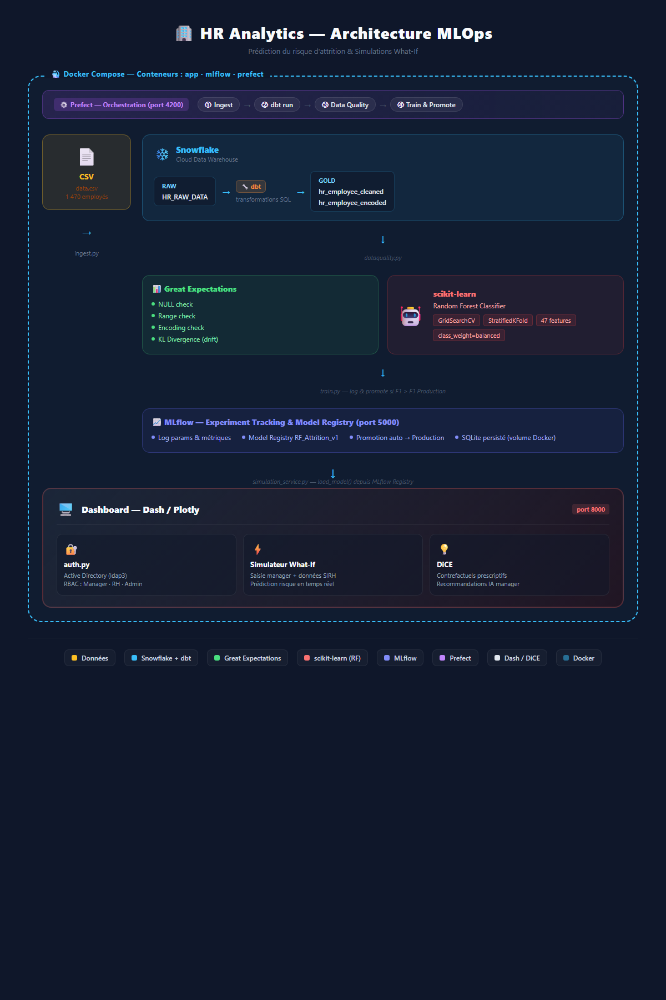

# HR Analytics — Data Engineering & MLOps

> Pipeline de données et de Machine Learning pour analyser les facteurs liés à l'attrition des employés, estimer leur risque de départ et explorer des scénarios de simulation à travers un dashboard interactif.

**Technologies :** Python · SQL · Snowflake · dbt · Prefect · Great Expectations · scikit-learn · MLflow · Dash / Plotly · DiCE · Docker

## Objectif

Construire une solution de bout en bout combinant **Data Engineering, qualité des données, Machine Learning et visualisation** :

- Centraliser les données RH dans Snowflake.
- Nettoyer, transformer et préparer les variables pour le Machine Learning avec dbt.
- Contrôler la qualité des données et illustrer la détection de dérive (*data drift*).
- Entraîner et suivre un modèle de prédiction de l'attrition.
- Proposer un dashboard et un simulateur de scénarios pour explorer les prédictions.

## Architecture



### Étapes du pipeline

| Étape | Technologies | Rôle |
|---|---|---|
| 1. Ingestion | Python, Pandas, Snowflake | Lecture du CSV, validation initiale et chargement des données RH dans la couche RAW |
| 2. Transformation | dbt, SQL, Snowflake | Nettoyage, préparation et encodage des variables pour l'analyse et le ML |
| 3. Qualité des données | Great Expectations, Python | Vérification de contraintes métier et tests sur les données préparées |
| 4. Entraînement | scikit-learn | Entraînement d'un Random Forest avec recherche d'hyperparamètres et validation croisée |
| 5. Suivi ML | MLflow | Suivi des expériences, métriques et versions du modèle |
| 6. Orchestration | Prefect | Enchaînement des étapes ingestion → transformation → qualité → entraînement |
| 7. Restitution | Dash, Plotly, DiCE | Visualisation RH et exploration de scénarios de simulation |

## Machine Learning et MLOps

La variable cible est **`ATTRITION`**. Le pipeline d'entraînement utilise un **Random Forest Classifier**, une **validation croisée stratifiée** et une recherche d'hyperparamètres avec `GridSearchCV`.

Les métriques suivies dans MLflow incluent notamment :

- **Accuracy** : proportion de prédictions correctes.
- **F1-score** : équilibre entre précision et rappel.
- **Best CV F1** : meilleur F1-score obtenu pendant la validation croisée.

Le projet comprend aussi une logique de gestion des versions du modèle dans MLflow. Les résultats chiffrés ne sont pas indiqués ici, car ils dépendent des exécutions d'entraînement.

## Qualité des données et data drift

Les contrôles portent notamment sur les valeurs manquantes, les plages autorisées et la cohérence de certaines variables RH.

Le script `app/dataquality.py` contient également une **démonstration de data drift simulé** : il crée un échantillon de référence et modifie artificiellement la variable `MONTHLYINCOME` afin d'illustrer la détection d'un changement de distribution. Il ne s'agit pas d'une surveillance de données réelles en production.

## Dashboard et simulation

L'application **Dash / Plotly** permet d'explorer les données RH et propose un **simulateur de risque d'attrition**. Le module `app/simulation_service.py` utilise notamment **DiCE** pour explorer des scénarios contrefactuels à partir des prédictions du modèle.

Ce simulateur est un outil d'exploration : ses résultats ne constituent pas une recommandation automatique de décision RH.

## Structure du projet

```text
hr-analytics-project-main/
├── app/
│   ├── data/data.csv              # Données d'entrée
│   ├── ingest.py                  # Ingestion Snowflake
│   ├── flow.py                    # Orchestration Prefect
│   ├── dataquality.py             # Contrôles de qualité et drift simulé
│   ├── train.py                   # Entraînement et suivi MLflow
│   ├── dashboard.py               # Interface Dash / Plotly
│   ├── simulation_service.py      # Simulation et contrefactuels
│   └── auth.py                    # Authentification de l'application
├── dbt_hr_project/
│   ├── models/                    # Modèles SQL de transformation
│   ├── dbt_project.yml
│   └── profiles.yml
├── docker/
│   ├── docker-compose.yml
│   ├── Dockerfile
│   ├── requirements.txt
│   └── .env.example
├── reports/
│   └── ml_ready_validation.json
└── architecture.png
```

## Exécution locale

**Prérequis :** Docker, Docker Compose et un compte Snowflake configuré avec les droits nécessaires.

1. Cloner le dépôt et se placer à sa racine.
2. Créer le fichier d'environnement à partir de l'exemple :

   ```bash
   cp docker/.env.example docker/.env
   ```

3. Compléter `docker/.env` avec ses propres paramètres Snowflake et identifiants d'application. **Ne jamais publier ce fichier.**
4. Démarrer les services :

   ```bash
   docker compose -f docker/docker-compose.yml up --build -d
   ```

5. Lancer le pipeline depuis le conteneur applicatif :

   ```bash
   docker compose -f docker/docker-compose.yml exec app python app/flow.py
   ```

6. Pour lancer le dashboard :

   ```bash
   docker compose -f docker/docker-compose.yml exec app python app/dashboard.py
   ```

**Interfaces locales :** Dashboard `http://localhost:8000` · MLflow `http://localhost:5000` · Prefect `http://localhost:4200`.

> **Remarque :** le conteneur applicatif est maintenu actif par défaut (`tail -f /dev/null`) ; le pipeline et le dashboard doivent donc être lancés explicitement. La configuration Snowflake, les schémas et les dépendances doivent être vérifiés pour reproduire l'environnement.

## Compétences mises en pratique

- Conception d'un pipeline analytique et ML de bout en bout.
- Transformation de données avec SQL et dbt dans Snowflake.
- Orchestration de workflows avec Prefect.
- Validation des données avec Great Expectations.
- Entraînement et suivi d'expériences avec scikit-learn et MLflow.
- Développement d'un dashboard interactif et d'un simulateur de scénarios.
- Conteneurisation des services avec Docker Compose.

---

*Projet de démonstration technique et de portfolio. Les prédictions doivent être interprétées avec prudence et ne doivent pas servir seules à prendre des décisions individuelles en matière de ressources humaines.*
